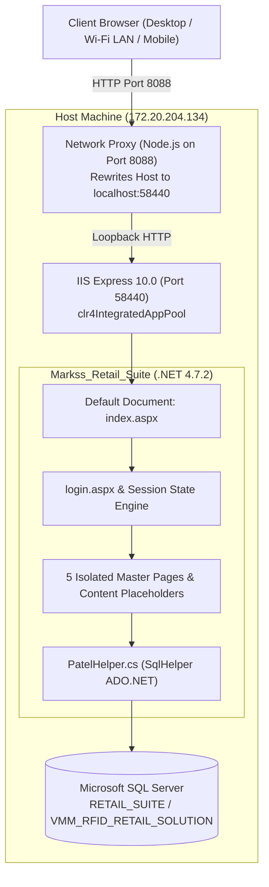

# 🏛️ Markss Retail Suite (Vyapti) — Complete Architecture & Application Flow

> **Document Version**: 1.0  
> **Target Scope**: End-to-end Architectural Topology, Request Lifecycle, Master Page Hierarchy, and Network Hosting Specification.

---

## 📑 Table of Contents
1. [Executive Summary & High-Level Architecture](#1-executive-summary--high-level-architecture)
2. [End-to-End Request & Authentication Flow](#2-end-to-end-request--authentication-flow)
3. [Master Page Hierarchy & Navigation Mechanics](#3-master-page-hierarchy--navigation-mechanics)
4. [Universal Single Sign-On (SSO) & Hub Architecture](#4-universal-single-sign-on-sso--hub-architecture)
5. [Local Development & Network Hosting Architecture](#5-local-development--network-hosting-architecture)

---

## 1. Executive Summary & High-Level Architecture

**Markss Retail Suite** (Vyapti) is an enterprise RFID-enabled Supply Chain & Retail ERP suite developed by Markss Infotech Ltd. It governs the upstream lifecycle of retail merchandise before and during distribution to retail stores.

### Technology Stack
* **Web Framework:** ASP.NET Web Forms (.NET Framework 4.7.2)
* **Language:** C# 7.3+
* **Data Access Layer:** Direct ADO.NET using `SqlHelper` (`PatelHelper.cs`)
* **Database Engine:** Microsoft SQL Server (calling central Stored Procedures e.g., `[SP_MASTER]`, `[SP_MASTER1]`)
* **Frontend UI Engine:** ASP.NET Server Controls, Bootstrap 3/4, Metronic UI Bundle (`assets/css/style.bundle.css`, `assets/js/scripts.bundle.js`), FontAwesome 4.7, AjaxControlToolkit, jQuery
* **Runtime & Web Server:** Microsoft IIS / IIS Express (integrated pipeline)



---

## 2. End-to-End Request & Authentication Flow

### The Legacy (Current) Login Lifecycle
1. **Entry Point (`index.aspx`):**
   * Displays 6 module tiles: *System Configuration, HQ Operations, Vendor Management System, Warehouse Management System, Store Operations, Reports & Analytics*.
   * Each tile contains an anchor tag pointing to `login.aspx?menu=<ModuleName>`.
2. **Authentication Screen (`login.aspx`):**
   * Reads `Request.QueryString["menu"]` and displays it in `lblMenuName`.
   * User enters `txtUsername` and `txtPassword`.
   * On Click `btnLogin_Click`:
     * Calls `[SP_MASTER]` with `@Action = 'LOGIN_CHECK'`, `@USER_NAME`, `@PASSWORD`, and `@USER_MODULE_NAME = lblMenuName.Text`.
     * If credentials and module are valid (`CODE == "1"`):
       - Sets `Session["USER_ID"]`, `Session["UserName"]`, `Session["ROLE_NAME"]`, `Session["DEPT_NAME"]`, `Session["USER_TYPE"]`, `Session["DESIGNATION"]`.
       - Sets `Session["MenuText"] = lblMenuName.Text`.
       - Redirects to that specific module's landing dashboard (e.g. `HQ_Operations/HQ_Dashboard.aspx`).
3. **The Problem With Legacy Flow:**
   * Session is tied to only *one* `MenuText` at a time.
   * If an administrator wants to visit `Warehouse_Management_System`, navigating back to `index.aspx` forces them to re-enter credentials because `index.aspx` points to `login.aspx?menu=Warehouse Management System`.

---

## 3. Master Page Hierarchy & Navigation Mechanics

The application is structured into **5 independent Master Pages**, each governing a physical subdirectory:

| Master Page Path | Code-Behind File | Controls Subdirectory | Primary Dashboard |
| :--- | :--- | :--- | :--- |
| `Configuration_Module/Config_Module.Master` | `Config_Module.Master.cs` | `/Configuration_Module/` | `User_Master.aspx` |
| `HQ_Operations/HQ_Operations.Master` | `HQ_Operations.Master.cs` | `/HQ_Operations/` | `HQ_Dashboard.aspx` |
| `Vendor_Management_System/Vendor_Management.Master` | `Vendor_Management.Master.cs` | `/Vendor_Management_System/` | `Vendor_Dashboard.aspx` |
| `Warehouse_Management_System/Warehouse_Management.Master` | `Warehouse_Management.Master.cs` | `/Warehouse_Management_System/` | `Warehouse_Dashboard.aspx` |
| `Store_Operations/Store_Operations.Master` | `Store_Operations.Master.cs` | `/Store_Operations/` | `Store_Operations_Dashboard.aspx` |
| `Retail_Suite.Master` (Root Master) | `Retail_Suite.Master.cs` | Root directory | `Dashboards.aspx`, `HO_Dashboard.aspx` |

### The Master Page Invariant Check
Every Master Page executes this security gate on `Page_Load`:
```csharp
if (!IsPostBack)
{
    if (Session["MenuText"] != null && Session["UserName"] != null && Session["User_ID"] != null)
    {
        // Binds allowed menus and submenus from [SP_MASTER] using @Action = 'GET_ACCESS_MENU_SUB_MENU'
        BIND_ACCESS_MENU(Session["MenuText"].ToString());
    }
    else
    {
        // Kicks unauthenticated sessions back to landing
        Response.Redirect("../index.aspx");
    }
}
```

---

## 4. Universal Single Sign-On (SSO) & Hub Architecture

To solve the repetitive login and navigation barriers, the system adopts this unified design:

```
[ User visits index.aspx ]
            │
      Is Authenticated?
      ├── NO ──► Show Central Login Form (Username + Password)
      │               │ (Authenticates once against SP_MASTER)
      │               ▼
      └── YES ─► Reveal 6-Card Module Hub (All 6 cards visible)
                      │
                      ├──► Authorized Card: Bright, hover elevation, direct 1-click routing.
                      └──► Unauthorized Card: .card-locked (grayscale, lock badge, SweetAlert on click).
```

### Invariant Rules for Module Switching
1. **Never drop the user session** when switching components.
2. Clicking an authorized card updates `Session["MenuText"]` to that module's exact string and immediately calls `Response.Redirect()`.
3. In each Master Page top navbar, provide a **"Switch Module / Hub"** button linking back to `~/index.aspx`.

---

## 5. Local Development & Network Hosting Architecture

### Why IIS Express Blocks External Network Clients
By default, IIS Express registers bindings for `localhost:58440`. When an external PC requests `http://172.20.204.134:58440/`, HTTP.sys rejects it with:
```text
HTTP Error 400. The request hostname is invalid.
```

### The Zero-Admin Solution (User-Space Network Proxy)
1. **IIS Express** runs normally on `localhost:58440`:
   ```powershell
   & "C:\Program Files\IIS Express\iisexpress.exe" /path:"<project-path>" /port:58440 /systray:false
   ```
2. **Node.js Network Proxy** listens on `0.0.0.0:8088`:
   * Forwards requests to `127.0.0.1:58440`.
   * Automatically rewrites the `Host` header to `localhost:58440`.
   * Allows all other PCs on the Wi-Fi/LAN (`http://172.20.204.134:8088/`) to browse the application with zero admin privileges and zero registry tweaks.
