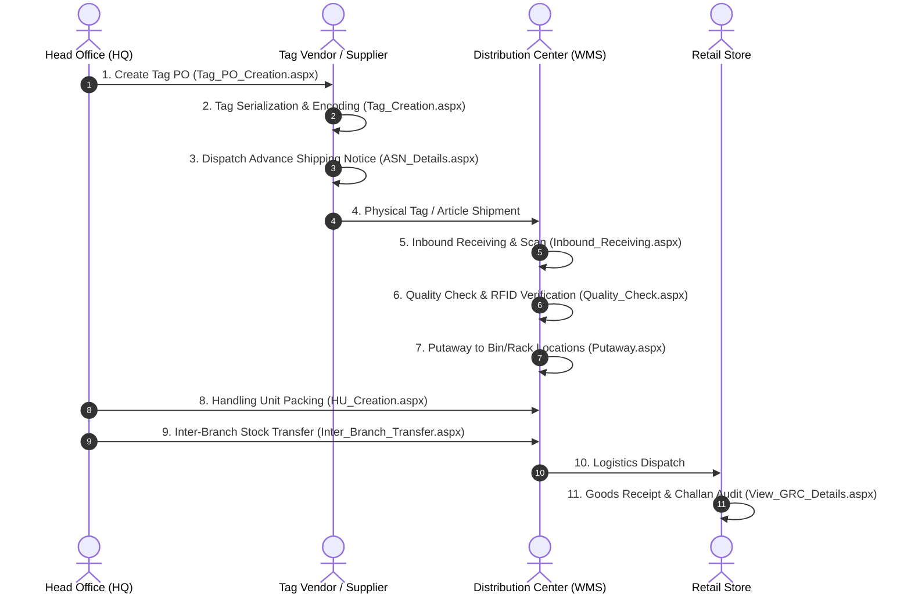

# 📦 Markss Retail Suite (Vyapti) — Complete Modules & Page Catalog

> **Document Version**: 1.0  
> **Target Scope**: Exhaustive Page Directory, Upstream Business Workflows, Forms, Grids, and Operational Interactions.

---

## 📑 Table of Contents
1. [Core Supply Chain Workflow Map](#1-core-supply-chain-workflow-map)
2. [Module 1: HQ Operations (Headquarters Level)](#2-module-1-hq-operations-headquarters-level)
3. [Module 2: Vendor Management System (VMS)](#3-module-2-vendor-management-system-vms)
4. [Module 3: Warehouse Management System (WMS)](#4-module-3-warehouse-management-system-wms)
5. [Module 4: Store Operations](#5-module-4-store-operations)
6. [Module 5: System Configuration](#6-module-5-system-configuration)
7. [Root Level & Dashboard Pages](#7-root-level--dashboard-pages)

---

## 1. Core Supply Chain Workflow Map

This suite models the enterprise retail supply chain from manufacturer tagging to final retail receipt:

---

## 2. Module 1: HQ Operations (Headquarters Level)

**Directory:** `/HQ_Operations/`  
**Master Page:** `HQ_Operations.Master`

### A. Master Data Management (MDM Catalogs)
These 14 pages define the foundational master records consumed by the entire enterprise:

| Page Name | Description | Key Interactivity |
| :--- | :--- | :--- |
| `Brand_Master.aspx` | Brand creation and code assignment | Add/Edit/Status toggle GridView |
| `Category_Master.aspx` | Merchandise category hierarchy | Category code, Name, Active status |
| `Department_Master.aspx` | Company departments (HQ, IT, Retail, Accounts) | Department mapping |
| `Designation_Master.aspx` | Employee designations and tiers | Title, Tier level |
| `EAN_Master.aspx` | International Article Numbers / Barcodes | EAN code, SKU mapping |
| `Employee_Master.aspx` | Internal staff registration | Name, Contact, Dept, Designation |
| `HSN_Master.aspx` | Harmonized System Nomenclature (Tax codes) | HSN Code, GST/Tax rate slabs |
| `Location_Master.aspx` | Physical building / zone coordinates | State, City, PIN, Address |
| `Material_Master.aspx` | Raw materials and fabric/product compositions | Material code, Description |
| `Product_Master.aspx` | Core SKU definitions, sizes, colors, MRP | Product ID, Style code, Description |
| `Reader_Master.aspx` | Fixed RFID Antennas, Readers & Handheld guns | Reader IP, MAC Address, Antenna Port |
| `Store_Registration.aspx` | Retail Store setup | Store Code, Store Name, Location ID |
| `Vendor_Master.aspx` | Supplier & Manufacturer registry | Vendor code, Contact, GSTIN, Address |
| `Warehouse_Master.aspx` | Distribution Center (DC) setup | WH Code, WH Name, Capacity, City |

### B. Headquarters Operational Workflows
| Page Name | Description | Workflow Role |
| :--- | :--- | :--- |
| `Tag_PO_Creation.aspx` | Issue purchase orders for RFID tags to tag vendors | Generates Tag PO Number, specifies tag types (inlay, hangtag, care label) |
| `Work_Order_Creation.aspx` | Work orders for garment manufacturing/tagging | Binds articles to Work Order Number |
| `HU_Creation.aspx` | Handling Unit creation (cartons, boxes, pallets) | Aggregates individual scanned items into a parent HU Barcode |
| `View_HU_Details.aspx` | Drilldown into contents of any HU | Displays all EPC tags packed inside an HU |
| `Logistics_Planning.aspx` | Route planning and vehicle allocation | Dispatches HU shipments between warehouses and stores |
| `Inter_Branch_Transfer.aspx`| Stock transfers between branches | Creates IBT Challan, adjusts in-transit inventory |
| `Stock_Movement.aspx` | Audit trail of physical merchandise movement | Tracks movement history by SKU / EPC / Date |
| `View_Work_Order_Details.aspx` | Work order inspection | Status tracking (Pending, Dispatched, Closed) |
| `HQ_Dashboard.aspx` | Central executive metrics | Macro inventory counts, active POs, dispatch charts |

---

## 3. Module 2: Vendor Management System (VMS)

**Directory:** `/Vendor_Management_System/`  
**Master Page:** `Vendor_Management.Master`

| Page Name | Description | Workflow Role |
| :--- | :--- | :--- |
| `Vendor_Dashboard.aspx` | Supplier landing metrics | Pending work orders, completed tagging batches |
| `Work_Order_Details.aspx` | Vendor-facing view of assigned work orders | Allows vendor to inspect SKU requirements for tagging |
| `Tag_Receive_Ack.aspx` | Acknowledge receipt of physical blank RFID tags | Tag Vendor acknowledges tag delivery from manufacturer |
| `Tag_Creation.aspx` | RFID Tag encoding and serialization | Uploads CSV tag batches (`Uploads/Tag_Creation_File.csv`) |
| `ASN_Details.aspx` | Advance Shipping Notice creation | Generates ASN barcode for warehouse receiving |

---

## 4. Module 3: Warehouse Management System (WMS)

**Directory:** `/Warehouse_Management_System/`  
**Master Page:** `Warehouse_Management.Master`

| Page Name | Description | Workflow Role |
| :--- | :--- | :--- |
| `Warehouse_Dashboard.aspx`| Warehouse inventory and inbound metrics | Inbound vs. Outbound volume graphs |
| `Inbound_Receiving.aspx` | Receiving shipments against ASN numbers | Scans incoming cartons/ASNs, validates manifest |
| `View_Receiving_Details.aspx` | Detailed itemized receiving log | Compares manifest quantities against scanned quantities |
| `Quality_Check.aspx` | Quality assurance & RFID readability check | Verifies that RFID tags respond to reader antennas |
| `Putaway.aspx` | Bin and rack storage allocation | Maps validated articles/HUs to physical warehouse bin locations |
| `View_HU_Details.aspx` | Warehouse-level HU inspection | Disassembles or inspects Handling Units |

---

## 5. Module 4: Store Operations

**Directory:** `/Store_Operations/`  
**Master Page:** `Store_Operations.Master`

| Page Name | Description | Workflow Role |
| :--- | :--- | :--- |
| `Store_Operations_Dashboard.aspx` | Store-level inventory metrics | Daily receipts, active stock, audit stats |
| `View_GRC_Details.aspx` | Goods Receipt / Challan validation | Verifies shipments delivered from DC to the retail store |

---

## 6. Module 5: System Configuration

**Directory:** `/Configuration_Module/`  
**Master Page:** `Config_Module.Master`

| Page Name | Description | Workflow Role |
| :--- | :--- | :--- |
| `User_Master.aspx` | Complete User & Role Access Management | Creates user logins, binds employee records, assigns permissions |

---

## 7. Root Level & Dashboard Pages

**Directory:** Root `/`  
**Master Page:** `Retail_Suite.Master` or Standalone

| Page Name | Role |
| :--- | :--- |
| `index.aspx` | Main entry portal (hosts module selection and unified login) |
| `login.aspx` | Legacy login screen (accepts `?menu=...` query string) |
| `Dashboards.aspx` | Root multi-module dashboard aggregator |
| `HO_Dashboard.aspx` | Head Office central inventory overview |
| `Reports_Dashboard.aspx` | Analytics dashboard and reporting launcher |
| `Store_Dashboard.aspx` | General store metrics overview |
| `Warehouse_Dashboard.aspx` | General warehouse metrics overview |
| `Invoice_Generation.aspx` | Sales invoicing and billing generation |
| `Invoice_Receiving.aspx` | Supplier invoice matching |
| `Tag_PO_Creation.aspx` | Root shortcut for Tag PO operations |
| `Supplier_Management.aspx` | Central supplier list and status management |
